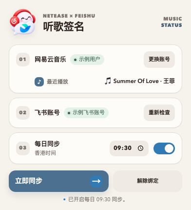

# 网易云听歌同步飞书签名

一个轻量的 Chrome 扩展：读取网易云音乐账号最近播放的一首歌，并把自己的飞书个性签名更新为：

```text
🎵 歌名 · 歌手
```

扩展直接使用当前 Chrome 中已登录的网易云音乐和飞书网页会话，不需要额外安装 CLI，也没有开发者中转服务器。



## 功能

- 自动识别网易云音乐网页登录账号
- 读取账号“最近播放歌曲”中时间最新的一首
- 核对并绑定当前飞书账号，避免误更新其他账号
- 手动立即同步
- 自定义每天的同步时间，默认香港时间 `09:30`
- Chrome 在设定时间后启动时，当天自动补跑一次
- 切换飞书账号时明确提示并关闭旧账号的每日同步
- 本地解除绑定，不修改飞书当前签名

## 使用条件

- Chrome 120 或更高版本
- Chrome 中已登录 [网易云音乐网页版](https://music.163.com/)
- Chrome 中已登录 [飞书网页版](https://www.feishu.cn/)
- 定时同步时 Chrome 需要正在运行；电脑休眠时会在唤醒后尝试补跑

## 本地安装

1. 下载仓库源码并解压。
2. 在 Chrome 地址栏打开 `chrome://extensions/`。
3. 开启右上角的“开发者模式”。
4. 点击“加载已解压的扩展程序”。
5. 选择仓库中的 `chrome` 文件夹。

更新源码后，在扩展管理页点击本扩展的“重新加载”即可。

## 首次设置

1. 点击扩展中的网易云音乐“登录”。
2. 在新标签页完成登录，然后重新打开扩展；账号和最近播放会自动检查。
3. 点击飞书账号“检查”，确认昵称后选择“绑定此账号”。
4. 先点击“立即同步”验证两个网页登录状态都有效。
5. 选择时间并开启“每日同步”。

所有定时均按香港时间（UTC+8）计算。

## 定时策略

扩展使用 `chrome.alarms` 创建浏览器内定时任务，不依赖 Codex 或系统级定时器。

- 每次闹钟触发后再安排下一次运行。
- 如果设定时间到达时电脑正在休眠，Chrome 唤醒后会触发延迟闹钟。
- 如果 Chrome 在当天设定时间之后才启动，并且当天尚未运行，扩展会补跑一次。
- 当天已经尝试过同步（包括数据源暂时不可用）时，不会持续重复请求。

## 权限说明

| 权限 | 用途 |
| --- | --- |
| `storage` | 保存绑定的飞书账号 ID、同步时间和最近运行结果 |
| `alarms` | 每日定时同步与启动后补跑 |
| `cookies` | 读取两个网站在当前 Chrome 中的登录会话 |
| `declarativeNetRequestWithHostAccess` | 仅在扩展请求期间把登录 Cookie 附加到对应网站请求 |
| `music.163.com` | 读取网易云账号与最近播放 |
| `login.feishu.cn` | 核对当前飞书账号 |
| `internal-api-lark-api.feishu.cn` | 写入当前用户的飞书签名 |

Cookie 仅用于向其所属平台发送请求，不写入扩展存储，也不发送给项目作者或第三方服务器。完整说明见 [PRIVACY.md](PRIVACY.md)。

## 已知限制

- 飞书没有公开的个人签名写入 OpenAPI。本项目使用飞书网页版内部接口，平台改版后可能需要更新。
- 扩展无法可靠读取修改前的飞书签名，因此不提供“恢复原签名”。解除绑定只会停止扩展，不会修改当前签名。
- 如果你手动修改了飞书签名，下一次出现新的最近播放歌曲时，已开启的自动同步仍可能覆盖它。
- 网易云“最近播放”依赖账号侧记录；移动端播放需要先同步到网易云账号。
- 本项目与网易云音乐、飞书及其关联公司没有隶属、授权或背书关系。

## 开发与验证

项目没有第三方运行时依赖。安装 Node.js 20 或更高版本后运行：

```bash
npm run check
npm test
```

`npm run check` 会验证扩展清单、图标尺寸和 JavaScript 语法；测试覆盖香港时间计算与签名格式。

## 项目结构

```text
chrome/               Chrome 扩展源码，可直接“加载已解压”
  background.mjs      消息路由、绑定、同步与闹钟策略
  feishu.mjs          飞书账号核对与签名写入
  netease.mjs         网易云账号与最近播放读取
  schedule.mjs        香港时间计算
  signature.mjs       签名格式清理
  popup.*             扩展弹窗界面
tests/                无依赖单元测试
scripts/validate.mjs  发布前静态检查
docs/                 发布与界面文档
```

## 发布

GitHub 发布前请按照 [发布检查清单](docs/PUBLISHING.md) 操作。完整审查结果见 [发布审查记录](docs/AUDIT.md)，版本变化见 [CHANGELOG.md](CHANGELOG.md)，安全问题报告方式见 [SECURITY.md](SECURITY.md)。

## 图标与品牌

本项目使用的 3D 音乐与飞书气泡图标由项目作者原创并提供，和代码一起按照 GPL-3.0-only 授权。网易云音乐、飞书及其标志仍属于各自权利人；详见 [商标与品牌声明](TRADEMARKS.md)。

## 许可证

本项目按照 [GNU General Public License v3.0 only](LICENSE) 发布，SPDX 标识为 `GPL-3.0-only`。

你可以使用、研究、修改和重新分发本项目，也可以收费分发；但发布原版或修改版时必须继续使用 GPL-3.0、保留许可证与版权声明，并向接收者提供对应源代码。本项目不提供任何担保。
